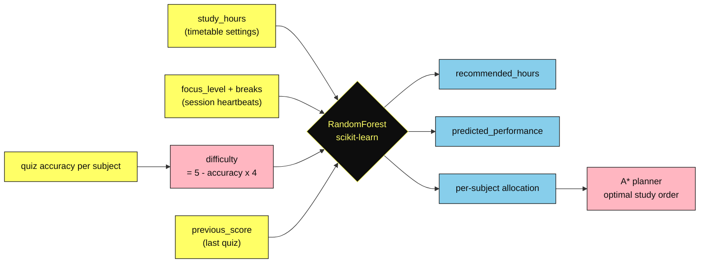
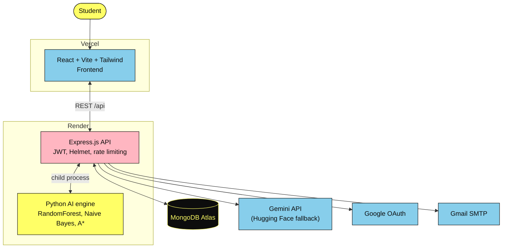

<div align="center">


<br/><br/>

<a href="https://frontend-dev-ketan.vercel.app"></a>
<a href="#quick-start"></a>
<a href="https://github.com/dev-ketan-1603/STAI/issues"></a>

<br/><br/>

           

</div>

<br/>

<p align="center">
  <a href="#what-is-stai"><b>About</b></a> &nbsp;·&nbsp;
  <a href="#features"><b>Features</b></a> &nbsp;·&nbsp;
  <a href="#ai-engine"><b>AI Engine</b></a> &nbsp;·&nbsp;
  <a href="#architecture"><b>Architecture</b></a> &nbsp;·&nbsp;
  <a href="#quick-start"><b>Quick Start</b></a> &nbsp;·&nbsp;
  <a href="#environment"><b>Environment</b></a> &nbsp;·&nbsp;
  <a href="#deployment"><b>Deployment</b></a> &nbsp;·&nbsp;
  <a href="#roadmap"><b>Roadmap</b></a>
</p>

<p align="center"></p>

<a id="what-is-stai"></a>
<h2>&nbsp;What is STAI?</h2>

**STAI (Smart Study AI)** is an AI-powered study platform that stops handing every student the same generic timetable.

It watches **how you actually study**: how long you plan to study, how focused you are, how many breaks you take and how you score on quizzes. A small stack of classical AI techniques (a RandomForest predictor, a Naive Bayes difficulty classifier and an A\* study-path planner) then turns those signals into a **personalised plan**, while generative AI handles summaries, quizzes and practice questions.

> **The more you use it, the better it knows you.** Every quiz you take sharpens the next timetable.

<p align="center"></p>

<a id="features"></a>
<h2>&nbsp;Features</h2>

<table>
  <tr>
    <td width="50%" valign="top">
      &nbsp;<b>Dashboard</b><br/>
      <sub>One home for your subjects, progress and AI predictions.</sub>
    </td>
    <td width="50%" valign="top">
      &nbsp;<b>Smart Study Materials</b><br/>
      <sub>Upload PDFs, paste YouTube links or add any resource and get AI summaries and key insights.</sub>
    </td>
  </tr>
  <tr>
    <td valign="top">
      &nbsp;<b>AI Quiz</b><br/>
      <sub>Take quizzes per subject. Your accuracy feeds straight into the difficulty model.</sub>
    </td>
    <td valign="top">
      &nbsp;<b>Practice Question Generator</b><br/>
      <sub>MCQs, short answers and essay questions tailored to your notes and difficulty level.</sub>
    </td>
  </tr>
  <tr>
    <td valign="top">
      &nbsp;<b>Personalised Timetable</b><br/>
      <sub>Study hours per subject, weighted towards the topics you struggle with.</sub>
    </td>
    <td valign="top">
      &nbsp;<b>Exam Dates</b><br/>
      <sub>Add your exam schedule and let the planner work backwards from it.</sub>
    </td>
  </tr>
  <tr>
    <td valign="top">
      &nbsp;<b>Growth Analysis</b><br/>
      <sub>See where you are improving and where to focus next.</sub>
    </td>
    <td valign="top">
      &nbsp;<b>Focus and Break Tracking</b><br/>
      <sub>Session heartbeats measure focus level and breaks while you study.</sub>
    </td>
  </tr>
  <tr>
    <td valign="top">
      &nbsp;<b>Secure Accounts</b><br/>
      <sub>JWT sessions, hashed passwords, rate limiting and Google sign-in.</sub>
    </td>
    <td valign="top">
      &nbsp;<b>Profile</b><br/>
      <sub>Your subjects, level and settings in one place.</sub>
    </td>
  </tr>
</table>

<p align="center"></p>

<a id="ai-engine"></a>
<h2>&nbsp;AI Engine</h2>

STAI is built as a formal **intelligent agent** (the app even shows its own PEAS breakdown: Performance, Environment, Actuators, Sensors). The engine lives in `backend/ai_service/` and Node.js calls it through a Python child process.

<table>
  <tr>
    <td width="25%" valign="top" align="center"><br/><b>RandomForest Predictor</b><br/><sub>Predicts performance and recommends daily study hours.</sub></td>
    <td width="25%" valign="top" align="center"><br/><b>Naive Bayes Classifier</b><br/><sub>Labels each subject <code>Easy</code>, <code>Medium</code> or <code>Hard</code>.</sub></td>
    <td width="25%" valign="top" align="center"><br/><b>Timetable Generator</b><br/><sub>Priority = 100 − accuracy, so weak subjects get more hours.</sub></td>
    <td width="25%" valign="top" align="center"><br/><b>A* Path Planner</b><br/><sub>Finds the optimal order to work through your subjects.</sub></td>
  </tr>
</table>



<details>
<summary><b>Step-by-step: what happens when you open the Timetable page</b></summary>

<br/>

1. Reads your saved **`study_hours`** from the timetable settings
2. Reads today's **`focus_level`** and **`breaks`** from session tracking (heartbeats sent while you are online)
3. Reads your latest **quiz scores** per subject and computes `difficulty = 5 − (accuracy × 4)`
4. Takes the **`previous_score`** from your last quiz (or the current score if it is your first)
5. Runs the **5 values** through the trained **RandomForest** model
6. Returns **`recommended_hours`**, **`predicted_performance`** and a **per-subject hour allocation**

</details>

<details>
<summary><b>How the A* planner is formulated</b></summary>

<br/>

| Element | Definition |
|---|---|
| **State** | The set of subjects completed so far |
| **Goal** | Every subject completed |
| **g(n)** | Hours spent on completed subjects (actual cost) |
| **h(n)** | Hours still needed for remaining subjects (admissible, never overestimates) |
| **f(n)** | `g(n) + h(n)` |

Lower quiz accuracy means more allocated hours, so harder subjects are naturally tackled early on the optimal path.

</details>

<p align="center"></p>

<a id="architecture"></a>
<h2>&nbsp;Architecture</h2>



<details>
<summary><b>REST API at a glance</b></summary>

<br/>

| Route | Purpose |
|---|---|
| `/api/auth` | Register, login, Google sign-in |
| `/api/profile` | User profile |
| `/api/subjects` | Subjects |
| `/api/exams` | Exam dates |
| `/api/timetable` | Timetable settings and generation |
| `/api/quiz` | Quizzes and scores |
| `/api/questions` | Practice question generator |
| `/api/study-materials` | Uploaded resources and summaries |
| `/api/growth` | Growth analysis |
| `/api/session` | Focus and break tracking |
| `/api/ai`, `/api/ai-predict` | Generative AI and ML predictions |
| `/api/contact` | Contact form (email) |

</details>

<p align="center"></p>

<a id="tech-stack"></a>
<h2>&nbsp;Tech Stack</h2>

<div align="center">

| Layer | Technology |
|:---:|:---|
| **Frontend** | React 18 · Vite · Tailwind CSS · Framer Motion · React Router · Lucide icons |
| **Backend** | Node.js · Express · Helmet · express-rate-limit · JWT · bcrypt |
| **Database** | MongoDB Atlas |
| **AI / ML** | Python · scikit-learn (RandomForest, Gaussian Naive Bayes) · pandas · joblib · A* search |
| **Generative AI** | Google Gemini (Hugging Face fallback) |
| **Auth** | JWT · Google OAuth 2.0 |
| **Email** | Nodemailer (Gmail SMTP) |
| **Hosting** | Vercel (frontend) · Render (backend) |

</div>

<p align="center"></p>

<a id="quick-start"></a>
<h2>&nbsp;Quick Start</h2>

> **Prerequisites:** Node.js 18+, Python 3.9+ and a MongoDB Atlas connection string.

**1. Clone**

```bash
git clone https://github.com/dev-ketan-1603/STAI.git
cd STAI
```

**2. Backend**

```bash
cd backend
npm install
npm run setup-ai          # installs scikit-learn, pandas, joblib
cp .env.example .env      # then fill in your keys (see Environment below)
npm run dev               # http://localhost:5000
```

**3. Frontend**

```bash
cd frontend
npm install
cp .env.example .env      # optional locally, see Environment below
npm run dev               # http://localhost:5173
```

**4. Open** [http://localhost:5173](http://localhost:5173), create an account and take a quiz to watch your timetable adapt.

<p align="center"></p>

<a id="environment"></a>
<h2>&nbsp;Environment</h2>

<details open>
<summary><b>Backend</b> &nbsp;<code>backend/.env</code></summary>

<br/>

| Variable | Description |
|---|---|
| `NODE_ENV` | `development` or `production` |
| `PORT` | API port (default `5000`) |
| `JWT_SECRET` | Long random string used to sign tokens (`openssl rand -base64 48`) |
| `MONGODB_URI` | MongoDB Atlas connection string |
| `MONGODB_DB_NAME` | Database name (default `stai`) |
| `FRONTEND_URL` | Allowed CORS origin(s), comma-separated |
| `SERVE_FRONTEND` | `true` to serve the built frontend from Express |
| `GOOGLE_CLIENT_ID` | Google OAuth 2.0 client ID |
| `GEMINI_API_KEY` / `GEMINI_MODEL` | Primary generative AI provider |
| `HF_API_KEY` / `AI_MODEL` | Hugging Face fallback provider |
| `MAIL_HOST` `MAIL_PORT` `MAIL_USER` `MAIL_PASS` `MAIL_FROM_NAME` | Gmail SMTP (use a Google App Password) |
| `PYTHON_BIN` | Python executable (`py` on Windows, `python3` on Linux/macOS) |

</details>

<details>
<summary><b>Frontend</b> &nbsp;<code>frontend/.env</code></summary>

<br/>

| Variable | Description |
|---|---|
| `VITE_API_URL` | Backend base URL in production (falls back to `http://localhost:5000/api` locally) |
| `VITE_GOOGLE_CLIENT_ID` | Google OAuth 2.0 client ID for the sign-in button |

</details>

> **Never commit your `.env` files.** Keep secrets in your hosting dashboard.

<p align="center"></p>

<a id="project-structure"></a>
<h2>&nbsp;Project Structure</h2>

```text
STAI/
├── frontend/                 React + Vite + Tailwind CSS
│   └── src/
│       ├── pages/            Dashboard, Quiz, Timetable, Growth, Materials ...
│       ├── components/       Sidebar, AIPredictionPanel, PEASPanel ...
│       ├── context/          Auth state
│       └── utils/            API client
├── backend/                  Express.js API
│   ├── routes/               auth, quiz, timetable, growth, session ...
│   ├── middleware/
│   └── ai_service/           Python AI engine
│       ├── ai_engine/        predictor, classifier, planner, generator
│       ├── model/            training script
│       └── saved_model/      trained RandomForest
└── package.json
```

<p align="center"></p>

<a id="deployment"></a>
<h2>&nbsp;Deployment</h2>

| Part | Platform | What to set |
|---|---|---|
| **Frontend** | Vercel | `VITE_API_URL` (your Render backend URL ending in `/api`) and `VITE_GOOGLE_CLIENT_ID`. `vercel.json` already rewrites all routes to `index.html`. |
| **Backend** | Render | All variables from the backend table above, with `FRONTEND_URL` set to your Vercel domain. Make sure the Python dependencies are installed in the build step. |

Add your Vercel domain to **Authorized JavaScript origins** in Google Cloud Console so Google sign-in works in production.

<p align="center"></p>

<a id="roadmap"></a>
<h2>&nbsp;Roadmap</h2>

- [x] RandomForest-powered study hour recommendations
- [x] Naive Bayes difficulty classification and A\* study path planning
- [x] Quiz, question generator and study material summaries
- [x] Focus and break tracking with session heartbeats
- [x] Google sign-in and rate-limited, JWT-secured API
- [ ] Mobile-friendly PWA
- [ ] Richer analytics and exportable progress reports
- [ ] Collaborative study spaces

<p align="center"></p>

<a id="contributing"></a>
<h2>&nbsp;Contributing</h2>

Ideas, bug reports and pull requests are welcome.

1. Fork the repo
2. Create a branch: `git checkout -b feature/your-idea`
3. Commit: `git commit -m "Add your idea"`
4. Push: `git push origin feature/your-idea`
5. Open a Pull Request

<p align="center"></p>

<div align="center">


### Built by [Ketan](https://github.com/dev-ketan-1603)

B.Tech CSE (AI/ML), Lovely Professional University

**If STAI helped you study smarter, give it a star.**

<a href="https://github.com/dev-ketan-1603/STAI"></a>

</div>
